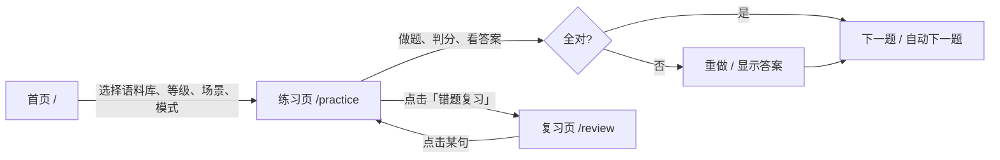

# Dictation Fun — 卡通趣味英语默写练习站

> **Next.js 14 + React + TypeScript + Tailwind CSS + SQLite**
>
> 按 CEFR 等级 (A1–C2) 和 8 大生活场景分类练习，**填空题** 与 **整句默写** 双模式，键盘直打、逐字判分、错题自动进复习本。

---

## ✨ 核心特性

| 功能 | 说明 |
|------|------|
| **双练习模式** | 填空题（优先使用语料库挖空词） / 整句默写（实词逐个敲） |
| **等级 × 场景** | CEFR A1–C2 六档 + 日常/旅行/美食/购物/学习/工作/健康/社交 8 场景 |
| **实时判分** | 回车即判：全对绿✅、写错红字母+显示你写的、漏写红虚线框、多写灰划掉 |
| **答案揭示** | ⌘/Ctrl+Enter 或点击按钮，直接在句子里亮出正确答案，并显示中文翻译 |
| **错题复习本** | 正确率 < 70% 自动入库，专门页面集中复习，支持清空 |
| **本地持久化** | SQLite (`better-sqlite3`) 记录每次作答、统计、复习调度，重启不丢 |
| **卡通趣味风** | 温暖配色、圆角卡片、弹跳/浮动动画、表情符号装饰，轻松不枯燥 |
| **键盘优先** | Space/Tab 跳格、←→ 跨词、Esc 重做、Enter 判分、⌘H 首字母提示、⌘/Ctrl+Enter 看答案 |

---

## 📦 快速开始

```bash
# 1. 进入项目
cd english-dictation

# 2. 安装依赖
npm install

# 3. 导入内置语料到 SQLite（只需跑一次）
npm run import:data

# 4. 启动开发服务器
npm run dev
# → 打开 http://localhost:3000
```

> 生产构建：`npm run build && npm start`

---

## 🗂️ 项目结构

```
english-dictation/
├── app/
│   ├── api/
│   │   ├── datasets/route.ts      # 获取语料库列表
│   │   ├── sentences/route.ts     # 按条件抽题
│   │   ├── records/route.ts       # 保存作答记录
│   │   └── stats/route.ts         # 统计/错题复习
│   ├── globals.css                # Tailwind + 卡通主题
│   ├── layout.tsx                 # 根布局
│   ├── page.tsx                   # 🏠 首页：选语料库/等级/场景/模式
│   ├── practice/page.tsx          # ✏️ 练习页：填空/默写核心交互
│   └── review/page.tsx            # 🔥 复习页：错题集中练
├── components/                    # (可拆分的共享组件)
├── lib/
│   ├── sqlite.ts                  # 数据库连接 & CURD
│   ├── constants.ts               # 等级/场景/模式定义
│   └── import-sentences.mjs       # 一次性导入旧版 JSON 语料
├── legacy/                        # 旧版单文件版（已归档）
├── data/dictation.db              # SQLite 数据库（运行时生成）
├── tailwind.config.ts             # 卡通色板、动画、圆角
├── tsconfig.json
├── next.config.js
└── package.json
```

---

## 🎯 页面流程



---

## ⌨️ 快捷键速查

| 按键 | 功能 |
|------|------|
| `字母/数字/符号` | 直接落入当前空格 |
| `Space` / `Tab` | 跳到下一个空（`Shift+Tab` 上一个） |
| `←` `→` | 在当前词内移动光标；到边界自动跨词 |
| `Backspace` | 删光标前字母；词首回退上一词 |
| `Esc` | 清空当前空；已判分时重做本题 |
| `Enter` | 判分（全对自动下一题） |
| `⌘/Ctrl + Enter` | 显示答案 |
| `⌘/Ctrl + H` | 首字母提示开关 |

---

## 🗄️ 数据库设计 (SQLite)

```sql
-- 语料库
datasets(id, name, source, description, created_at)

-- 句子
sentences(id, dataset_id, level, category, text, zh, blanks[JSON], source, created_at)

-- 每次作答记录
practice_records(id, sentence_id, dataset_id, mode, correct, mistakes, time_spent, typed_text, created_at)

-- 句子级统计（用于复习调度）
sentence_stats(sentence_id, total_attempts, correct_count, last_attempt_at, next_review_at)
```

**复习调度规则**（简化版）：
- 做错 → 1 小时后 `next_review_at` 再出现
- 连对 3 次 → 视为掌握，暂不安排复习
- 正确率 < 70% → 复习页优先展示

---

## 📚 语料来源

| 数据集 | 句数 | 来源 | 备注 |
|--------|------|------|------|
| `builtin` | 126 | 人工整理 | CEFR A1–C2 均衡，含中文翻译、指定挖空 |
| `tatoeba` | 600 | [Tatoeba](https://tatoeba.org/en/downloads) | 英↔中句对，CC BY 2.0 FR / CC0；等级由 CEFR-J + Octanove 词表启发式估计 |

> **开源题材调研结论**：目前无现成「英语默写题库」，通用做法是拿 Tatoeba 等句子库按词表切题。本项目已把导出/清洗/定级/入库流程自动化（`lib/import-sentences.mjs`）。

---

## 🔧 常用命令

```bash
# 开发
npm run dev

# 生产构建
npm run build
npm start

# 重新导入语料（修改 legacy/data 后）
npm run import:data

# 检查类型
npx tsc --noEmit

# 数据库文件位置
ls -la data/dictation.db
```

---

## 🛠️ 技术栈

- **框架**：Next.js 14 (App Router)
- **语言**：TypeScript 5
- **样式**：Tailwind CSS 3（自定义卡通色板、关键帧动画）
- **动画**：Framer Motion 11
- **图标**：Lucide React
- **数据库**：better-sqlite3 (SQLite, WAL 模式)
- **字体**：Inter (Google Fonts)

---

## 📄 许可

- **代码**：MIT
- **内置 126 句**：MIT
- **Tatoeba 600 句**：遵循 Tatoeba CC BY 2.0 FR / CC0（生成脚本头部已标注来源）
- **CEFR-J / Octanove 词表**：分别遵循「需引用」与 CC BY-SA 4.0

---

## 🙌 致谢

- [Tatoeba](https://tatoeba.org) — 开放多语例句库
- [CEFR-J Vocabulary Profile](https://github.com/openlanguageprofiles/olp-en-cefrj) — 词级 CEFR 标注
- [Octanove](https://github.com/openlanguageprofiles/olp-en-cefrj) — C1/C2 词表
- [Lucide](https://lucide.dev) / [Framer Motion](https://www.framer.com/motion/) / [Tailwind CSS](https://tailwindcss.com) — 优秀的开源工具

---

> 由单文件原型重构而来。如需扩展：听写模式、艾宾浩斯复习曲线、导出错题本、多用户、云同步…… 欢迎 PR 🎈